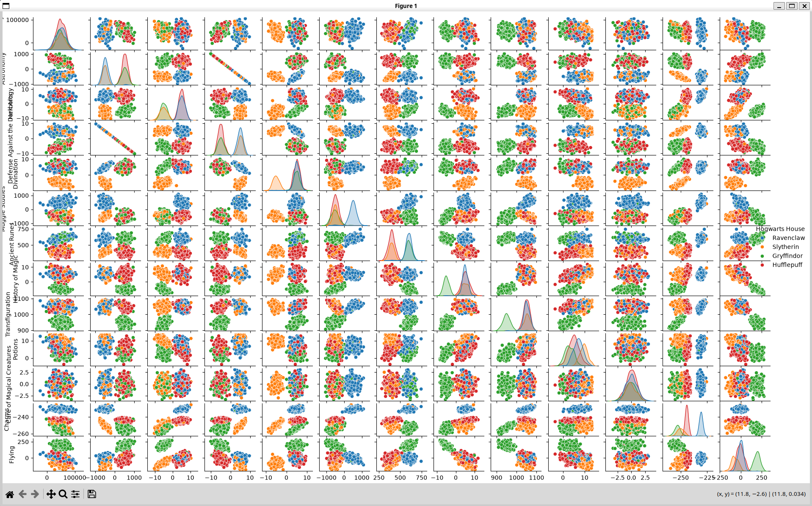

# Instalaciones
1. `python3 -m venv venv`
2. `source venv/bin/activate`
3. `pip install -r requirements.txt`

### Histogram
En el archivo de histogram, el objetivo es comparar todas las asignaturas y buscar los graficos que tengan las asignaturas mas parecidas (distrubuciones homogeneas)

### Pair_plot
Similar a histogram pero esta vez comparamos dos asignaturas. Cada punto representa un alumno.

Para ello creo una lista con todas las asignaturas y dentro de un bucle hago los graficos de todas, en el programa final solo incluyo uno de los 2 graficos que cumplen requisitos (Care of magical creatures y arithmancy)

    subjects = ["Arithmancy","Astronomy","Herbology","Defense Against the Dark Arts","Divination","Muggle Studies","Ancient Runes","History of Magic","Transfiguration","Potions","Care of Magical Creatures","Charms","Flying"]

## pair_plot.py

Seaborn ignora las columnas con texto, no queremos que dibuje los index, asi qeu los ignoramos

el resultado es este: 